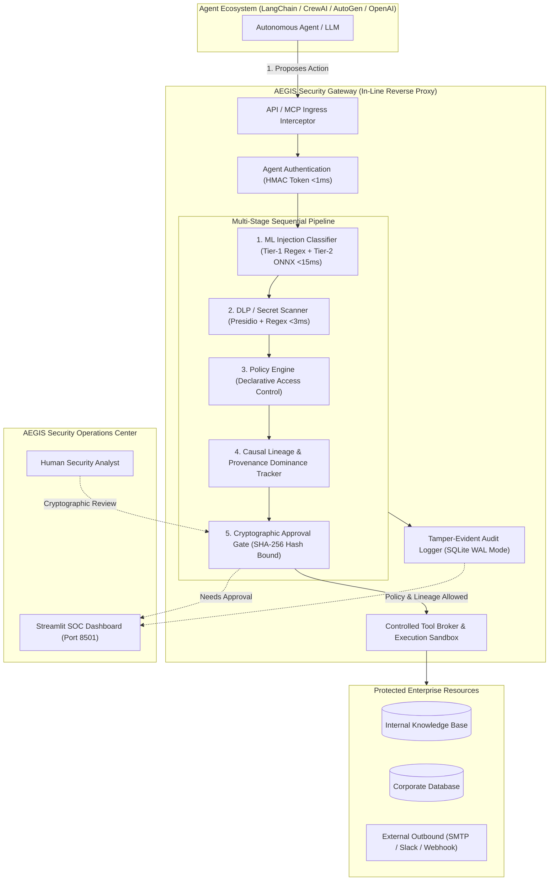

# 🛡️ AEGIS (Autonomous Entity Governance & Inspection Shield)

> **Enterprise AI Agent Information-Flow Security Gateway & Cryptographic Approval Proxy**  
> *Where Data Provenance Strictly Dominates Human Approval to Defeat Prompt Injection & Data Exfiltration.*

---

[](https://github.com/farhanmallik05/AEGIS-ai)
[](tests/)
[-blue)](evaluation/)
[-green)](evaluation/results/)
[](LICENSE)
[](https://www.python.org/)

---

## 1. What is AEGIS?

Autonomous AI agents (built with LangChain, CrewAI, AutoGen, or raw LLM tool-calling loops) are increasingly connected to databases, customer files, and external APIs. However, agents are inherently vulnerable to **Indirect Prompt Injection** and **Social Engineering Attacks** (OWASP LLM01, LLM02, LLM06).

A malicious document can instruct an agent to exfiltrate database records or trigger financial transfers. Even when a human reviewer is in the loop, attackers easily craft persuasive justifications that trick human operators into approving malicious actions.

**AEGIS solves this fundamental vulnerability:**
It is an in-line, transparent security gateway that intercepts agent tool calls and enforces **Causal Taint Lineage Tracking**. If an agent reads an untrusted or confidential document, that data permanently taints the agent's working session context. **Even if a human operator clicks "APPROVE", AEGIS blocks the outbound exfiltration because data provenance strictly supersedes human authorization.**

---

## 2. Architecture & Pipeline



---

## 3. Key Innovations & Differentiators

| Capability | Standard Agent Frameworks | General API Gateways | **AEGIS Gateway** |
|---|:---:|:---:|:---:|
| **Provenance-Driven Enforcement** | ❌ None | ❌ None | ✅ **Yes — Data lineage tracked across turns** |
| **Integrity Overrides Human Approval** | ❌ Human blindly trusted | ❌ N/A | ✅ **Yes — Tainted source blocks exfiltration even if approved** |
| **Cryptographic Approval Binding** | ❌ Ephemeral booleans | ❌ N/A | ✅ **Yes — Bound to SHA-256 payload canonical hash (No TOCTOU)** |
| **Real ML Injection Scanner** | ❌ None | ❌ String matches | ✅ **Yes — Two-tier heuristic + ONNX classifier (<15ms)** |
| **Data Loss Prevention (DLP)** | ❌ None | ⚠️ Basic regex | ✅ **Yes — Secrets, JWTs, AWS keys, PII redaction** |
| **PDF Document Security Analyzer** | ❌ None | ❌ None | ✅ **Yes — Stream extraction, zero-width stego & taint tagging** |
| **Attack Correlation (`attack_id`)** | ❌ Isolated logs | ❌ Uncorrelated | ✅ **Yes — Links initial prompt injection to downstream exfiltration** |
| **High Concurrency Database** | ❌ Lock contention | ⚠️ External DB | ✅ **Yes — SQLite WAL (0 locks under 50 concurrent workers)** |

---

## 4. Five-Member Engineering Team Breakdown (WBS)

| Member | Track / Role | Owned Modules | Thesis & Report Chapter |
|---|---|---|---|
| **Member 1** | **Team Lead — Gateway Core & Ingress Proxy** | `backend/app.py`<br>`backend/security/gateway.py`<br>`backend/security/approval_engine.py` | *System Architecture, Reverse Proxy Design & Cryptographic Token Binding* |
| **Member 2** | **AI Security Specialist — ML & DLP Engines** | `backend/security/ml_detector.py`<br>`backend/security/dlp_engine.py`<br>`tests/test_ml_detector.py` | *Adversarial Machine Learning, Injection Classification & Data Loss Prevention* |
| **Member 3** | **Policy & Lineage Specialist — Causal Taint & Provenance** | `backend/security/policy_engine.py`<br>`backend/security/provenance_context.py`<br>`backend/security/ifc_lattice.py` | *Causal Lineage Architecture, Provenance Dominance & Declarative Access Rules* |
| **Member 4** | **Full-Stack SOC Specialist — UI & Telemetry** | `frontend/dashboard.py`<br>`backend/security/pdf_analyzer.py`<br>`backend/app.py` (SSE `/audit/stream`) | *Human-Computer Interaction in Security Dashboards & Real-Time Threat Visualization* |
| **Member 5** | **DevOps & QA Engineer — Benchmarks & Packaging** | `Dockerfile`<br>`docker-compose.yml`<br>`evaluation/run_load_test.py`<br>`.github/workflows/ci.yml` | *Continuous Integration, Reliability Stress Benchmarking & Cloud Containerization* |

---

## 5. Quickstart Guide

### Option A: One-Click Automatic Launcher (Windows PowerShell)
The fastest way to run both the Gateway API and the Streamlit SOC Console:
```powershell
powershell -ExecutionPolicy Bypass -File .\scripts\run.ps1
```
* Automatically boots FastAPI on `http://127.0.0.1:8000`.
* Automatically boots Streamlit on `http://127.0.0.1:8501`.
* Automatically opens your default web browser to the SOC console.

To stop both services cleanly:
```powershell
powershell -ExecutionPolicy Bypass -File .\scripts\stop.ps1
```

---

### Option B: Manual Two-Terminal Setup
```bash
# 1. Install dependencies
pip install -r requirements.txt

# 2. Run unit and integration tests (114 tests)
python -m pytest tests/ -v

# 3. Terminal 1: Launch Security Gateway API
python -m uvicorn backend.app:app --host 127.0.0.1 --port 8000 --reload

# 4. Terminal 2: Launch Streamlit SOC Operations Console
python -m streamlit run frontend/dashboard.py --server.port 8501
```

* **FastAPI Backend & Interactive Swagger Docs:** [http://localhost:8000/docs](http://localhost:8000/docs)
* **Streamlit SOC Operations Console:** [http://localhost:8501](http://localhost:8501)

---

### Option C: One-Command Docker Launch
```bash
docker-compose up --build
```

---

## 6. Endpoints Reference

| Method | Endpoint | Auth Header | Description |
|---|---|---|---|
| `GET` | `/health` | None | Gateway health and status check (`{"status":"healthy"}`) |
| `POST` | `/actions` | `X-AEGIS-Agent-Token` | Submit an action proposal for inspection and sandbox execution |
| `GET` | `/approvals` | `X-AEGIS-Approver-Token` | List pending human approval requests |
| `POST` | `/approvals` | `X-AEGIS-Agent-Token` | Request a cryptographic human approval for an action |
| `POST` | `/approvals/{id}/review` | `X-AEGIS-Approver-Token` | Cryptographically Approve or Reject a pending request |
| `POST` | `/documents/upload` | `X-AEGIS-Agent-Token` | Upload a PDF document for stream extraction, zero-width stego check & provenance tagging |
| `GET` | `/documents` | `X-AEGIS-Agent-Token` | List registered documents with sensitivity and provenance levels |
| `GET` | `/documents/{resource}` | `X-AEGIS-Agent-Token` | Retrieve document preview and taint metadata |
| `GET` | `/audit` | `X-AEGIS-Admin-Token` | Query tamper-evident audit logs with filters |
| `GET` | `/audit/stream` | `X-AEGIS-Admin-Token` | Server-Sent Events (SSE) live incident telemetry stream |
| `GET` | `/audit/attacks/{id}` | `X-AEGIS-Admin-Token` | Retrieve complete multi-stage attack trace by correlation ID |

---

## 7. Streamlit SOC Console: 6 Interactive Tabs

Open the **SOC Console** at [http://localhost:8501](http://localhost:8501) to explore the 6 operational tabs:

1. **📊 Live Traffic & Threat Radar:** Real-time KPI metrics, attack distribution breakdowns, and live audit telemetry stream.
2. **🛡️ Zero-Trust HITL Approval Desk:** Review pending tool proposals with canonical SHA-256 payload hashes to prevent parameter tampering.
3. **🕸️ Causal Lineage Directed Acyclic Graph (DAG):** Interactive Plotly visualizer rendering session data lineage from ingestion to tool sinks.
4. **🎯 Interactive Sandbox Attack Simulator:**
   - **Scene 1 (Authorized Read):** Public document read $\rightarrow$ **ALLOW (18ms)** $\rightarrow$ Green SOC card.
   - **Scene 2 (Indirect Injection Detection):** Poisoned customer note $\rightarrow$ ML detector flags score **0.94+** $\rightarrow$ Context tagged **UNTRUSTED** $\rightarrow$ Amber SOC alert with `attack_id`.
   - **Scene 3 (The Human Approval Trap):** Deceived operator clicks **APPROVE**. Gateway runs lineage check $\rightarrow$ **DENIED BY PROVENANCE DOMINANCE** $\rightarrow$ Red alert!
   - **Scene 4 (Payload Tampering Defense):** Attacker modifies an approved payload $\rightarrow$ SHA-256 mismatch $\rightarrow$ **BLOCKED**.
5. **📄 Document Upload & PDF Security Analyzer:** Upload custom PDFs or quick-load sample documents (Benign Invoice, Adversarial Resume, Sensitive Contract) to test real-time steganography, prompt injection, and Presidio DLP extraction.
6. **💡 Idea Flow & System Architecture:** Visual bento cards detailing the conceptual foundation (The Human Approval Fallacy vs. Provenance Dominance) and subsystem architecture.

---

## 8. Verification & Empirical Benchmark Results

Run all 4 evaluation tiers in a single command via `powershell -ExecutionPolicy Bypass -File .\scripts\run_all_evaluations.ps1`:

```
==========================================================
   AEGIS: Full Academic Benchmark & Evaluation Suite      
==========================================================

>>> [1/4] Full Test Suite (pytest)
    114 passed in 3.39s | 100.0% Pass Rate across 20 modules

>>> [2/4] Scenario Evaluation Matrix (E01 - E10)
    10/10 Scenarios Passed | 100.0% Detection Rate | Mean Latency: 24.3ms

>>> [3/4] 300-Scenario Repeated Reliability Benchmark
    300/300 Executions Passed | Decision Match Rate: 100.0% | Mean: 27.3ms

>>> [4/4] 50-Worker High-Concurrency Load Stress Test
    50/50 Requests Succeeded | Throughput: 15.9 req/s | DB Locks: 0
==========================================================
```

---

## 9. Presentation & Academic Report Deliverables

- **PowerPoint Presentation Deck:** [`AEGIS_Idea_Presentation.pptx`](AEGIS_Idea_Presentation.pptx) (14 slides, High-End Dark Tech styling)
- **Standalone HTML5 Slide Deck:** [`frontend/deck.html`](frontend/deck.html) (open directly in any web browser)
- **Minor Project Report (Word):** [`KCC_AEGIS_Minor_Project_Report.docx`](KCC_AEGIS_Minor_Project_Report.docx) (conforming to KCC ITM / AKTU formatting rules)
- **Minor Project Report (Markdown):** [`docs/KCC_AEGIS_Minor_Project_Report.md`](docs/KCC_AEGIS_Minor_Project_Report.md)
- **Modular LaTeX Thesis Source:** [`docs/report_kcc/`](docs/report_kcc/)

---

## 10. Academic Citation

```bibtex
@misc{mallik2026aegis,
  author = {Farhan Mallik and AEGIS Engineering Team},
  title = {AEGIS: Autonomous Entity Governance & Inspection Shield with Information-Flow Provenance},
  year = {2026},
  publisher = {GitHub},
  howpublished = {\url{https://github.com/farhanmallik05/AEGIS-ai}}
}
```

*Built with FastAPI, Streamlit, PyMuPDF, Microsoft Presidio, ONNX Runtime, and SQLite WAL.*
